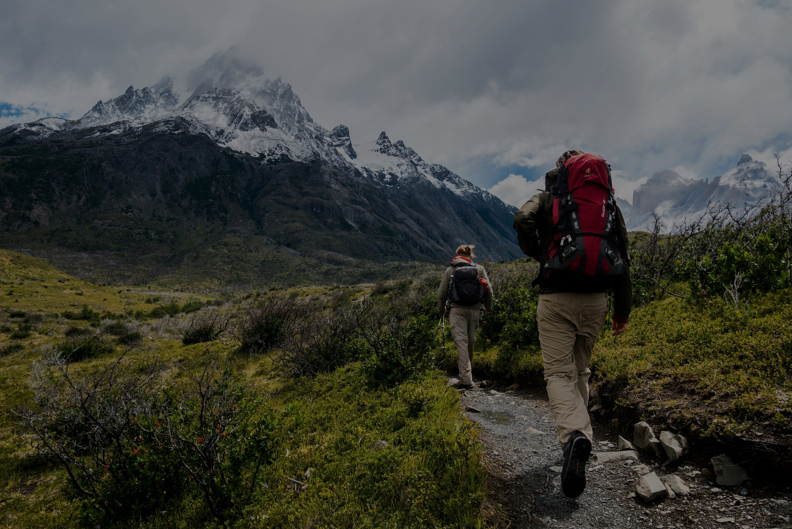

# 🇵🇰 DESTINATION PAKISTAN

<div align="center">


### ✨ Explore. Experience. Discover.

**A Tourism Website Showcasing the Natural Beauty, Culture, Destinations, and Adventures of Pakistan.**

<br/>

<a href="https://github.com/hassan1450/DESTINATION-PAKISTAN">

</a>


<br/><br/>



</div>

---

## 🌍 About The Project

**Destination Pakistan** is a tourism website designed to introduce people to the breathtaking beauty and cultural diversity of Pakistan.

From the magnificent mountains of the north to beautiful valleys, lakes, historical places, and cultural festivals, the platform provides visitors with an opportunity to explore different destinations and discover exciting travel experiences.

The website brings together destination information, adventure packages, photography, and travel-related details in one place.

Whether you love trekking, exploring new cultures, enjoying nature, or discovering hidden places, Destination Pakistan encourages you to experience the beauty of Pakistan.

## ✨ Key Features

| Feature | Description |
|---|---|
| 🏠 Home Page | Introduction to Pakistan and its tourism attractions. |
| 🗺️ Destinations | Explore popular tourist destinations with individual detail pages. |
| 🎒 Tour Packages | Discover different travel and adventure packages. |
| 🖼️ Photo Gallery | Explore beautiful photographs of Pakistan. |
| 🏔️ Adventure Tours | Discover trekking, skiing, safaris, and biking experiences. |
| 🎭 Cultural Experiences | Explore cultural tours and regional festivals. |
| ℹ️ About Us | Learn about the tourism platform and its mission. |
| 📩 Contact Us | Contact the platform through its contact page. |

## 🏔️ Explore Beautiful Destinations

Discover some of the most beautiful places in Pakistan.

<div align="center">


</div>

Some featured destinations include:

- Hunza Valley
- Fairy Meadows
- Skardu and Shangrila
- Swat Valley
- Kalash Valley
- Mushkpuri Top
- Rakaposhi Base Camp
- Khunjerab Pass
- Siri Paye
- Azad Kashmir
- Toli Peer

## 🧭 Tour Packages & Adventures

The website features different types of tourism experiences.

- 🏛️ Cultural Tours
- 🥾 Trekking Adventures
- 🦌 Wildlife Safaris
- 🎉 Festivals
- 🏍️ Bike Tours
- 🐾 Wildlife Tours
- ⛷️ Ski Tours
- 🚙 Overland Adventures
- 🌄 Special Interest Adventures

## 📸 Explore the Gallery

The photo gallery showcases the natural beauty of Pakistan through different categories, including:

- Mountains
- Desert Landscapes
- Seaside Views

## 🛠️ Technologies Used

<div align="center">


<br/><br/>


</div>

## 📂 Project Structure

```text
DESTINATION-PAKISTAN/
│
├── index.html
├── front.html
├── tour.html
├── destination.html
├── gallery.html
├── about.html
├── contact.html
│
├── styleh.css
├── style2.css
│
├── AZAD KASHMIR.html
├── Fairy.html
├── Hunza.html
├── Kalash.html
├── Mushkpuri.html
├── SIRI PAYE.html
├── SWAT.html
├── Shangrila.html
├── khunjerab.html
├── rakaposhi.html
├── tol ip eer.html
│
├── culture.html
├── festivals.html
├── treking.html
├── safarie.html
├── ski.html
├── bike.html
├── wild.html
│
├── Overland Adventure.html
├── Special Interest Adventure.html
│
├── mountain.jpg
├── hiking.jpg
└── h2.jpg
```

## 🚀 Getting Started

You can run this project locally on your computer.

**1. Clone the repository**

```bash
git clone https://github.com/hassan1450/DESTINATION-PAKISTAN.git
```

**2. Open the project folder**

```bash
cd DESTINATION-PAKISTAN
```

**3. Run the website**

Open `front.html` in your browser to explore the website.

No backend setup or package installation is required for the basic static website.

## 🎯 Project Objectives

- Promote tourism and travel opportunities in Pakistan.
- Showcase Pakistan's natural landscapes and cultural heritage.
- Provide information about tourist destinations.
- Present different adventure and travel experiences.
- Create an accessible online platform for exploring Pakistan.

## 🌟 Future Improvements

- [ ] Responsive design improvements for all devices.
- [ ] Interactive destination search and filtering.
- [ ] Online tour booking functionality.
- [ ] User registration and authentication.
- [ ] Dynamic destination management.
- [ ] Integration of interactive maps.
- [ ] Improved user experience and animations.

## 👨‍💻 Developer

<div align="center">

### Noor ul Hassan

**BS Information Technology | Web Development Enthusiast**

<a href="https://github.com/hassan1450">

</a>

</div>

## ⭐ Support

If you like this project, consider giving it a ⭐ on GitHub.

Your support motivates further development and encourages more projects showcasing the beauty of Pakistan.

---

<div align="center">

### 🇵🇰 PAKISTAN — A LAND OF BEAUTY, CULTURE & ADVENTURE

**Explore More. Travel More. Discover Pakistan.**


</div>
